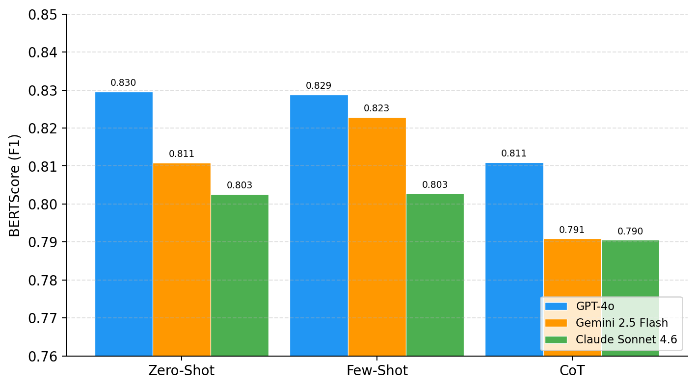

# Do Newer LLMs Do Better?
### Evaluating GPT-4o, Claude, and Gemini on Normal and Obfuscated Code Analysis

**Institution:** Toronto Metropolitan University  
**Supervisor:** Prof. Manar Alalfi  
**Author:** Ali Navab Zadeh  

---

## Overview

This project extends the work of Fang et al. (USENIX Security 2024) by evaluating three newer LLMs on code analysis tasks using three prompting strategies.

**Models evaluated:**
- GPT-4o (OpenAI)
- Claude Sonnet 4.6 (Anthropic)
- Gemini 2.5 Flash (Google)

**Tasks:**
- Code explanation (99 Python files)
- Obfuscated JavaScript analysis (5 obfuscation schemes)

**Prompting strategies:**
- Zero-shot
- Few-shot
- Chain-of-thought (CoT)

**How answers are scored:** each model's explanation is compared with the GPT-4 reference explanation from the Fang et al. dataset, using BERTScore (F1) and TF-IDF cosine similarity. A higher score means the answer is closer to the GPT-4 reference, not that it was checked for correctness by a person.

---

## Key Findings

| Model | Code explanation (BERTScore) | Obfuscated JavaScript (BERTScore) |
|---|---|---|
| GPT-4o | 0.823 | 0.849 |
| Gemini 2.5 Flash | 0.808 | 0.825 |
| Claude Sonnet 4.6 | 0.799 | 0.805 |

- **GPT-4o's answers were closest to the GPT-4 reference on both tasks.** Part of this may be because GPT-4o comes from the same model family as the reference.
- **Chain-of-thought prompting did not help.** On code explanation, it gave the lowest score of the three strategies for every model.
- **Zero-shot and few-shot scored about the same**, so the short examples added little.



**Notes on the data:**
- 98 of the 99 Python files had a matching reference explanation and were scored.
- For the obfuscated task, GPT-4o has results for 35 files, compared with 43 for Claude and Gemini, because some GPT-4o runs did not complete.

---

## Project Structure

```
llm-code-analysis/
├── prompts.py              # All 9 prompt functions
├── run_experiments.py      # API calls and experiment pipeline (resumable)
├── evaluate.py             # BERTScore and cosine similarity evaluation
├── show_figures.py         # Generate result figures
├── results_explanation.csv # Final explanation task results
├── results_obfuscated.csv  # Final obfuscated task results
├── figure*.png / .pdf      # Result figures
└── llms-for-code-analysis/ # Dataset from Fang et al. (clone separately, see Setup)
```

The experiment runner skips any model, strategy, and file combination that already has an output, and logs failed API calls without stopping, so a long run can be restarted safely.

---

## Setup

1. Clone this repository.
2. Install dependencies:

```
pip install -r requirements.txt
```

3. Create a `.env` file with your API keys:

```
OPENAI_API_KEY=your_key_here
ANTHROPIC_API_KEY=your_key_here
GOOGLE_API_KEY=your_key_here
```

4. Clone the dataset into the project folder:

```
git clone https://github.com/aseec-lab/llms-for-code-analysis
```

---

## Running the Experiments

```
python3 run_experiments.py
```

## Evaluating Results

```
python3 evaluate.py
```

## Generating Figures

```
python3 show_figures.py
```

---

## Dataset

Dataset from Fang et al.: https://github.com/aseec-lab/llms-for-code-analysis

---

## Reference

Fang et al. "Large Language Models for Code Analysis: Do LLMs Really Do Their Job?" USENIX Security 2024.
